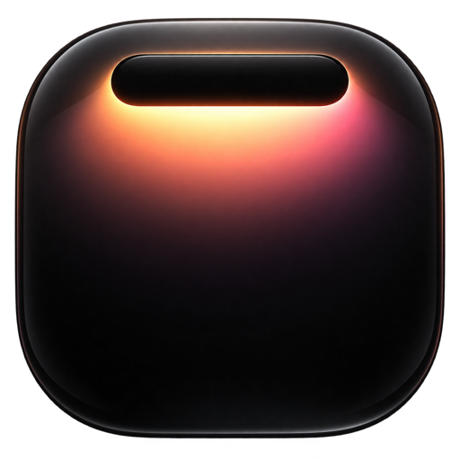
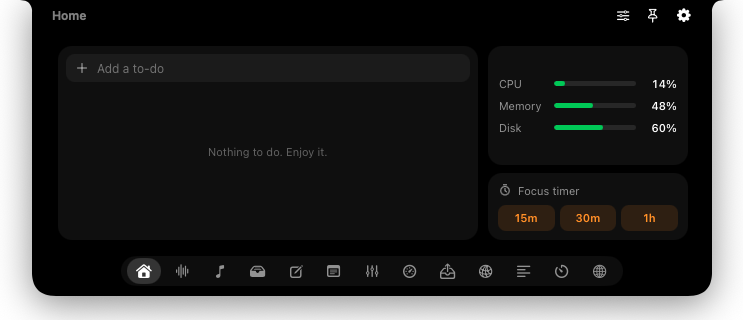

<p align="center">
  
</p>

<h1 align="center">Nook</h1>

<p align="center">
  <b>Your MacBook notch, finally useful.</b><br>
  A free, open-source notch app for macOS — and every tab is a plugin you can build in minutes.
</p>

<p align="center">
  <a href="https://github.com/YusufLisawi/nook/releases/latest/download/Nook.dmg"><b>Download for macOS</b></a> ·
  <a href="https://nook.motkan.com">Website</a> ·
  <a href="PLUGINS.md">Plugin docs</a>
</p>

<p align="center">
  
</p>

## What's inside

Hover the notch and it opens. Two-finger swipe between tabs. Drag tabs to reorder, give any tab a global shortcut, pin it open, size each tab the way you like. Works on every screen — monitors without a notch get one too.

| Tab | What it does |
|---|---|
| **Home** | To-dos, CPU / memory / disk at a glance, a one-tap focus timer |
| **Dictation** | Hold ⌃⌥ (or your shortcut) and talk — Groq Whisper + an AI cleanup pass, pasted where you type. History, retry, copy |
| **Mixer** | Per-app volume up to 200%, pick and pin your default mic and speakers |
| **Proxy** | Paste proxies, tap one, and the whole Mac goes through it (logins handled for you). Live IP check |
| **Monitor** | CPU, memory, disk, battery, network, top processes |
| **Notes** | Quick notes, pinned notes, search |
| **Teleprompter** | Your script scrolls right under the camera |
| **Shelf · Scratch · Timers · Media** | Drag files in and out, a scratch pad, timers, what's playing |

Everything is optional — turn tabs off in Settings.

## Install

**Or from Terminal:**

```bash
curl -fsSL https://nook.motkan.com/install.sh | bash
```

Or [download Nook.dmg](https://github.com/YusufLisawi/nook/releases/latest/download/Nook.dmg) and drag **Nook** to Applications. Signed with Developer ID and notarized by Apple.
3. Grant what you use: **Accessibility** (shortcuts, paste), **Microphone** (dictation), **System Audio Recording** (per-app volume).

Requires macOS 14.2 or later. Apple silicon and Intel.

## Build your own tab

A plugin is a folder with `plugin.json` + `index.html`. Nook loads it live — no Xcode, no rebuild.

```bash
nook new github-prs --name "PRs" --symbol arrow.triangle.pull   # live in the notch immediately
nook open github-prs        # show it
nook logs github-prs -f     # console.log + errors
nook validate github-prs    # check it against the rules
```

```js
// main.js — a native bridge is ready on window.nook
const { stdout } = await nook.shell('gh pr list --json title,url');
nook.activity.set({ text: '3 PRs', symbol: 'arrow.triangle.pull' }); // shows on the closed notch
```

Plugins get shell, HTTP without CORS, storage, system stats, notifications, live activities, drag & drop, the mixer, proxy and dictation engines — plus a settings form generated from `plugin.json`. See **[PLUGINS.md](PLUGINS.md)**, the **[UI guidelines](docs/UI-GUIDELINES.md)** and **[limits](docs/LIMITS.md)**.

### Let your AI build it

On first launch Nook installs the `nook` command and an agent skill for **Claude Code** and **Codex** (Settings → Command line & AI agents). Then just ask:

> make a nook plugin that shows my open GitHub pull requests

## Build from source

```bash
brew install xcodegen
git clone https://github.com/YusufLisawi/nook && cd nook
./scripts/make-dmg.sh          # universal build → dist/Nook.dmg
```

The project is generated from `project.yml`. Official builds are signed with Motkan LLC's Developer ID and notarized (`scripts/release.sh`). To build yourself, set `CODE_SIGN_IDENTITY` to `-` (ad-hoc) or your own identity and `DEVELOPMENT_TEAM` to your team.

## Credits

- Dictation follows the pipeline of [FreeFlow](https://github.com/zachlatta/freeflow) (MIT) — Groq Whisper + LLM cleanup — and can import your FreeFlow key, prompt and vocabulary.
- Built with SwiftUI, AppKit, WebKit and Core Audio process taps.

## License

[MIT](LICENSE) © 2026 Youssef El Aissaoui
